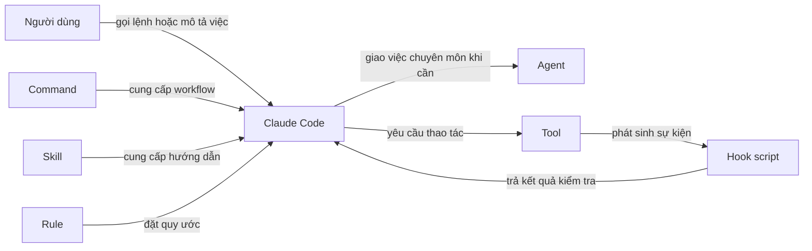

# Leaning Skill — học cách bộ YTL AI Labs skills hoạt động

Tài liệu tiếng Việt phân tích `ytlailabs-claude-skills`: bộ này làm gì, được nạp và chạy thế nào, cài ra sao, dùng lệnh nào và đọc mã nguồn từ đâu.

Đây là repo học tập độc lập, không phải plugin chính thức của YTL AI Labs. Nội dung được viết lại từ việc đọc một bản mã nguồn local; không đóng gói plugin hay sao chép dữ liệu vận hành. Tên repo giữ theo yêu cầu: **leaning-skill**.

## Hiểu nhanh

Một **skill** là bộ hướng dẫn để AI thực hiện một loại công việc. AI đọc hướng dẫn rồi sử dụng công cụ được cấp để làm việc. Script và hook mới là phần có thể chạy như chương trình; file `SKILL.md` không tự gọi API chỉ vì nó tồn tại.

| Thành phần | Vai trò | Ví dụ trong bộ được phân tích |
| --- | --- | --- |
| Skill | Hướng dẫn cách làm theo lĩnh vực | `tdd-workflow`, `jira` |
| Command | Điểm gọi một workflow bằng slash command | `/ytlailabs:plan` |
| Agent | Vai trò chuyên môn có chỉ dẫn riêng | `planner`, `code-reviewer` |
| Rule | Quy ước làm việc cần tuân thủ | testing, security, coding style |
| Hook | Script được host gọi theo sự kiện | kiểm tra sau khi sửa file |
| Tool / MCP | Khả năng thực thi hoặc truy cập hệ thống | Bash, công cụ API được cấu hình |

Sơ đồ mô tả các quan hệ chính; thứ tự nạp cụ thể do host và kiểu cài đặt quyết định. Không phải yêu cầu nào cũng đi qua mọi thành phần.

## Đọc theo thứ tự

1. [Kiến trúc và luồng chạy](docs/01-kien-truc-va-luong-chay.md): phân biệt prompt, agent và script.
2. [Cài đặt và sử dụng](docs/02-cai-dat-va-su-dung.md): bootstrap, wizard, command và troubleshooting.
3. [Mổ xẻ ba workflow](docs/03-mo-xe-workflow.md): plan, Jira workload và quality gate.
4. [Bản đồ 64 skills](docs/04-ban-do-skills.md): chọn nhóm phù hợp và cách đọc từng skill.
5. [Thực hành](docs/05-thuc-hanh.md): bài tập và prompt mẫu dùng dữ liệu giả.
6. [Bằng chứng và giới hạn](docs/06-bang-chung-va-gioi-han.md): phiên bản phân tích, phát hiện lệch tài liệu và các phần chưa kiểm thử.

## Phiên bản được phân tích

- Upstream khai báo: `frogasia/claude-skills`.
- Commit local: `190776b25ef9a741a5edb73de655d21064ef212f`.
- Phiên bản trong `package.json`: `1.0.0`.
- Kiểm đếm ở commit này: **17 agent, 64 skill, 53 command** trong các thư mục cấp cao tương ứng.
- Không khẳng định đây là phiên bản upstream mới nhất. Link upstream có thể yêu cầu quyền truy cập.

## Bắt đầu bằng việc nào?

Nếu mới học, hãy đọc kiến trúc, thử một yêu cầu lập kế hoạch trên project sandbox, rồi so sánh command với skill và agent liên quan. Chưa cần cấu hình Jira, Slack hay hạ tầng để hiểu phần cốt lõi.

Phân tích này tách rõ **mã đã đọc**, **cách dùng được đề xuất** và **hành vi chưa được kiểm thử trong môi trường thật**. Xem [phạm vi kiểm chứng](docs/06-bang-chung-va-gioi-han.md) trước khi dùng làm hướng dẫn triển khai.

## Ghi nhận nguồn

Bộ gốc ghi nhận phát triển từ [Everything Claude Code](https://github.com/affaan-m/everything-claude-code) của Affaan Mustafa, được YTL AI Labs mở rộng. Xem [NOTICE.md](NOTICE.md). Các bài viết trong repo này là phần giải thích độc lập.
