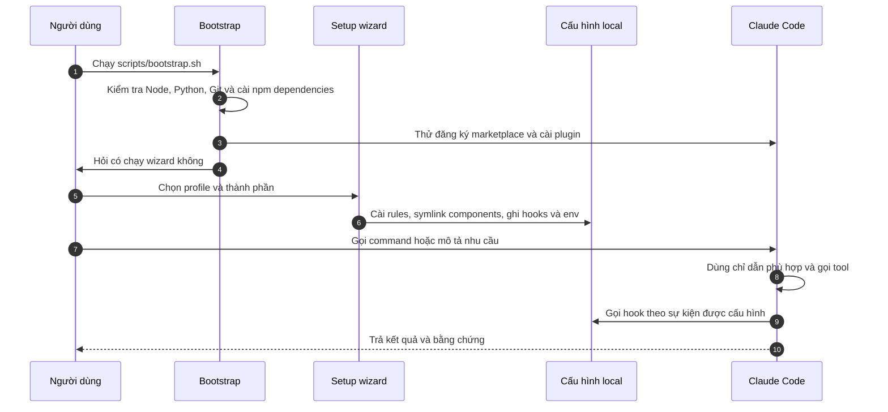

# Kiến trúc và luồng chạy

## 1. Bộ này giải quyết vấn đề gì?

Thay vì mỗi lần nhắc AI lại phải mô tả cách lập kế hoạch, viết test, review và truy cập dịch vụ, bộ này đóng gói các quy trình vào file Markdown, cấu hình JSON và script. Claude Code là host đọc và thực thi các phần phù hợp.

Nguồn đọc: `.claude-plugin/plugin.json`, `.claude-plugin/marketplace.json`, `scripts/bootstrap.sh`, `scripts/lib/setup-helpers.js`. Tất cả đường dẫn upstream trong tài liệu này được tính từ gốc repo nguồn tại commit trong [bảng bằng chứng](06-bang-chung-va-gioi-han.md).

## 2. Sáu lớp cần phân biệt

| Lớp | Nằm ở đâu trong nguồn | Ai xử lý? | Điều cần nhớ |
| --- | --- | --- | --- |
| Plugin manifest | `.claude-plugin/plugin.json` | Host/plugin loader | Tên plugin là `ytlailabs`; khai báo agents, skills, commands |
| Command | `commands/*.md` | Host nạp chỉ dẫn cho AI | Có command chỉ chuyển tiếp sang skill, có command yêu cầu gọi agent |
| Skill | `skills/<name>/SKILL.md` | AI đọc hướng dẫn | Có thể kèm script và tài nguyên; mức độ tự động phụ thuộc host |
| Agent | `agents/*.md` | Host và AI phối hợp giao việc | Là cấu hình vai trò; không phải một server thường trực |
| Rules / context | `rules/`, `contexts/`, `CLAUDE.md` | Được đưa vào ngữ cảnh theo cách cài | Quy tắc là chỉ dẫn; không tự bảo đảm mọi hành vi được cưỡng chế |
| Hook runtime | `hooks/hooks.json`, `scripts/hooks/` | Host gọi script | Có code thật, matcher sự kiện, profile, exit code và timeout |

Metadata như `description` giúp mô tả lúc nên dùng skill. Trường `classification` và `required-env` được công cụ setup đọc để phân nhóm và tìm biến thiếu. Chúng không tự cấp quyền hay tự tạo kết nối API.

## 3. Từ lúc cài đến lúc dùng

Luồng wizard có các thay đổi cụ thể: agents, commands và skills được symlink; contexts được copy; rules được copy bằng `cp -r`; hooks được ghi vào settings. Vì symlink trỏ vào bản clone, di chuyển hoặc xóa clone có thể làm hỏng đường dẫn đã cài.

## 4. Skill được “chạy” bằng cách nào?

Có ba tình huống khác nhau:

1. Người dùng gọi command như `/ytlailabs:whatsonmyplate`. File command yêu cầu AI dùng skill cùng tên.
2. Người dùng mô tả việc bằng ngôn ngữ tự nhiên. Host/AI có thể chọn skill phù hợp dựa vào mô tả và chỉ dẫn đã nạp. Đây không phải cam kết rằng mọi host đều tự kích hoạt giống nhau.
3. Host phát một sự kiện như `PostToolUse`. Cấu hình hook chọn script để chạy. Đây là thực thi code theo sự kiện, khác việc AI đọc skill.

Ví dụ: skill Jira có hướng dẫn đọc biến môi trường và thực hiện HTTP request bằng shell/Python. Không bắt buộc phải đi qua MCP. Công cụ nào được gọi phải xem trong chính skill đó, không suy ra từ tên tích hợp.

## 5. Hook chạy như thế nào?

Với hook đi qua `scripts/hooks/run-with-flags.js`, runtime đọc input từ stdin, kiểm tra hook ID/profile, kiểm tra đường dẫn script có nằm trong plugin root, rồi gọi `run(raw)` nếu module có export phù hợp. Nếu không, runtime dùng tiến trình Node con với timeout.

| Sự kiện | Vai trò trong snapshot |
| --- | --- |
| `SessionStart` | Nạp lại context và nhận diện package manager |
| `PreToolUse` | Nhắc nhở, kiểm tra trước thao tác, bảo vệ config và theo dõi |
| `PostToolUse` | Quality gate, format, typecheck, quan sát kết quả |
| `PostToolUseFailure` | Theo dõi lỗi công cụ MCP |
| `PreCompact` | Lưu trạng thái trước khi thu gọn context |
| `Stop` | Các tác vụ sau khi AI trả lời: lưu phiên, đánh giá, theo dõi chi phí |
| `SessionEnd` | Đánh dấu kết thúc phiên |

`Stop` không đồng nghĩa người dùng đã đóng phiên. Một số comment trong nguồn diễn đạt đơn giản hơn hành vi mà cấu hình đăng ký thể hiện.

## 6. Profile không phải mức kế thừa

`scripts/lib/hook-flags.js` đọc `ECC_HOOK_PROFILE`, mặc định `standard`, nhận `minimal`, `standard`, `strict`. Hàm kiểm tra dùng phép kiểm tra thành viên trong danh sách profile của từng hook. Vì vậy `strict` không tự bao gồm mọi hook của `minimal` nếu hook đó không khai báo `strict`.

`ECC_DISABLED_HOOKS` là danh sách hook ID ngăn cách bằng dấu phẩy. Các hook gọi trực tiếp, không đi qua wrapper/profile tương ứng, không nhất thiết chịu cơ chế này. Cần đọc command đăng ký cụ thể trong `hooks/hooks.json`.

## 7. Continuous learning thực tế

Trong `scripts/hooks/evaluate-session.js`, code đọc `transcript_path`, đếm message có type `user`, so với ngưỡng mặc định 10, tạo thư mục learned khi cần và ghi lời nhắc đánh giá. Script này không tự gọi LLM để trích xuất hay tự ghi `SKILL.md` mới.

Bộ nguồn còn có continuous-learning v2 và các lệnh instinct/evolve; đó là nhánh cơ chế khác. Không thể lấy mô tả “continuous learning” rồi kết luận mọi phiên đều tự biến thành skill hay làm thay đổi trọng số model.
