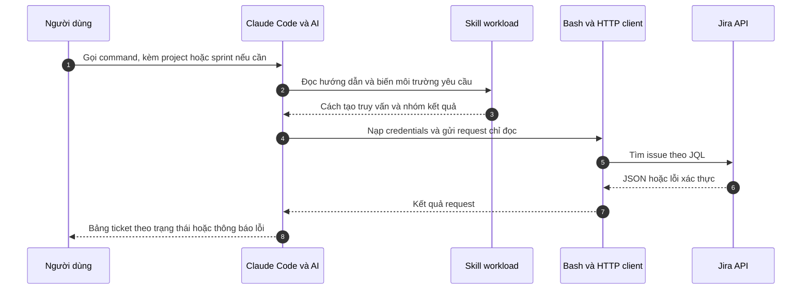
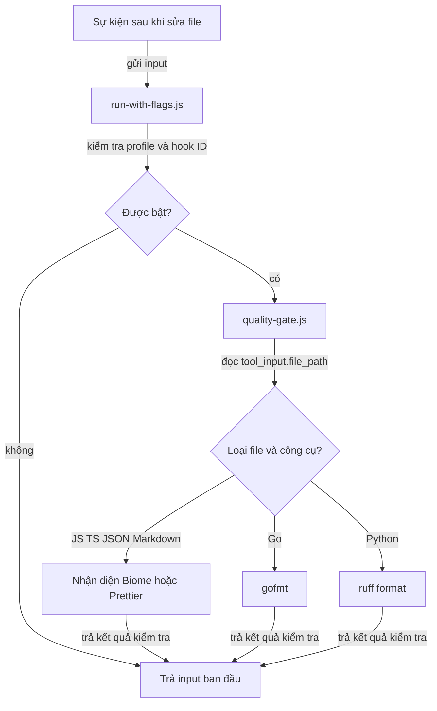

# Mổ xẻ ba workflow

## A. `/ytlailabs:plan`: chỉ dẫn gọi agent

File `commands/plan.md` mô tả quy trình: nhắc lại yêu cầu, nhận diện rủi ro, chia giai đoạn, chỉ ra dependencies và chờ xác nhận. Command yêu cầu dùng `planner`; vai trò tương ứng nằm ở `agents/planner.md`.

Điểm gọi này là một tài liệu chỉ dẫn cho AI. Bản thân file Markdown không có vòng lặp scheduler hay cơ chế khóa filesystem để ngăn sửa code. Việc thực hiện phải dựa vào host và model, rồi kiểm tra bằng kết quả thực tế.

Ví dụ học tập:

```text
/ytlailabs:plan Thêm chức năng tìm ghi chú theo tiêu đề.
Chỉ lập kế hoạch. Nêu test cho chuỗi rỗng, Unicode và không tìm thấy kết quả.
```

Một câu trả lời tốt có phạm vi, các file cần xem, hành vi kỳ vọng và tiêu chí kiểm tra. Chưa thể gọi là đã triển khai chỉ vì command trả một kế hoạch dài.

## B. `/ytlailabs:whatsonmyplate`: command chuyển sang skill rồi gọi API

Command `commands/whatsonmyplate.md` rất ngắn: yêu cầu dùng skill workload và chuyển tiếp filter người dùng. Logic hướng dẫn chi tiết nằm trong `skills/whatsonmyplate/SKILL.md`.



Những phần AI cần làm:

1. Hiểu filter được yêu cầu.
2. Đọc biến môi trường theo hướng dẫn của skill.
3. Dùng công cụ thực hiện truy vấn Jira.
4. Nhóm kết quả theo `fields.status.name`.
5. Hiển thị priority, sprint, due date và tổng số.

Skill nguồn có filter mặc định giới hạn một số project của tổ chức. Khi áp dụng cho môi trường riêng, cần truyền project phù hợp; không sao chép mặc định tổ chức sang mọi tài khoản. Field sprint cũng có thể là custom field khác giữa các instance.

MCP không xuất hiện như điều kiện bắt buộc của đoạn workflow này: hướng dẫn nguồn sử dụng HTTP client qua Bash. Có tên Jira trong danh mục tích hợp không đồng nghĩa một Jira MCP server đang chạy.

Ví dụ giả lập để học mà không gửi request:

```text
Đọc skill whatsonmyplate và giải thích luồng của nó.
Không gọi dịch vụ ngoài. Dùng ba ticket giả: DEMO-1 To Do,
DEMO-2 In Progress, DEMO-3 In Review. Trình bày bảng theo status.
```

## C. Quality gate: sự kiện gọi script thật

Trong `hooks/hooks.json`, `PostToolUse` với matcher `Edit|Write|MultiEdit` đăng ký `scripts/hooks/quality-gate.js` thông qua `run-with-flags.js`. Hook này khai báo async và profile `standard,strict`.



Code `quality-gate.js` đọc `ECC_QUALITY_GATE_FIX` và `ECC_QUALITY_GATE_STRICT` bằng so sánh chuỗi với `true`. Với JS/TS dùng Biome, nó bỏ qua nhánh đó vì post-edit formatter xử lý riêng. Khi không có formatter phù hợp, có thể không làm gì.

Điểm dễ hiểu sai: strict trong script này chủ yếu làm xuất cảnh báo. Hàm `run()` vẫn trả input gốc; hook được đăng ký async. Không thể suy ra “format lỗi thì chắc chắn chặn thao tác”. Muốn biết hook chặn hay chỉ cảnh báo, đọc cả registration lẫn return/exit code.

## D. TDD và coverage: ý định khác cưỡng chế

`skills/tdd-workflow/SKILL.md` yêu cầu RED → GREEN → REFACTOR, coverage tối thiểu 80% và checkpoint Git cho các giai đoạn. Đây là yêu cầu của workflow nguồn, không phải bằng chứng mọi project đã có test runner hay đo coverage.

`package.json` của chính bộ plugin có script `coverage` dùng c8 và ngưỡng 80%. Lệnh đó đo code của bộ plugin, không tự đo toàn bộ ứng dụng mà bạn đang nhờ AI sửa.

Khi đánh giá workflow, cần bằng chứng: test nào đã chạy, có thất bại đúng nguyên nhân trước sửa không, và sau sửa đã pass cùng test chưa. Với tài liệu thuần túy, dùng kiểm tra tài liệu phù hợp thay vì tạo test nghiệp vụ giả.
